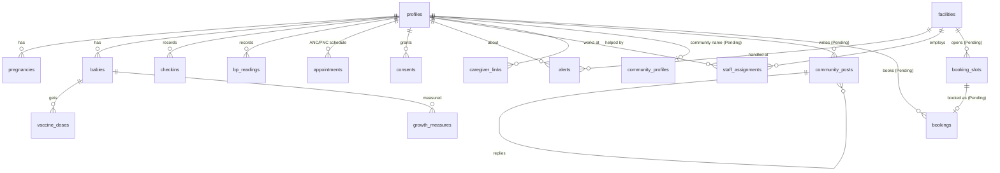

# Safari ya Mama: backend schema

Supabase project `qrkzzptfpcotirbvvmke` (Postgres + Auth + Storage + Edge Functions). This document lists every table, the server functions each part of the product uses, and the rules that protect the data. It was taken from the live database on 7 Nov 2026, plus the migration that is written but **not yet applied** (`20261106010000_community_bookings.sql`, marked **Pending** below).

The source of truth is `supabase/migrations/`. Change the schema only with a new migration file there; never by hand in the dashboard.

Related: [PRD](PRD.md) · [TRD](TRD.md) · [User flows](USER_FLOWS.md) · [`supabase/README.md`](../supabase/README.md) (deploy steps, contracts).

## 1. Rules every table follows

| Rule | How it is done |
|---|---|
| The app and dashboard only hold the public anon key | The service-role key exists only inside Edge Functions. |
| Every table has row-level security (RLS) on | A mother reads and writes only her own rows (`mother_id = auth.uid()`). Staff read a mother only through `can_read_mother()`, which requires her consent to share with their facility (`sharing_on()`). |
| Sensitive actions go through functions, not tables | `security definer` functions check the role with one helper per permission (`is_staff()`, `staff_of(facility)`, `is_platform_admin()`, `is_super_admin()`). The new community and appointment tables are closed to direct access entirely. |
| Records from the phone are never lost or duplicated | Rows have client-made UUIDs, `client_created_at`, `updated_at` and soft delete (`deleted_at`); the phone's outbox upserts them. `purge_deleted()` removes soft-deleted rows after 30 days. |
| Every look at a mother's record is recorded | `log_view(mother, what)` writes `audit_log`, which is append-only (trigger `audit_log_append_only`). |
| Warning levels match on phone and server | `rate_checkin()` / `rate_bp()` recompute the level on the server (`server_level`) with the same rules (`rule_signs`, `rules_version`). The higher of the two is shown. |
| Admin powers need two-factor sign-in | `is_platform_admin()` and `is_super_admin()` require `mfa_ok()` (session level `aal2`). |
| Small numbers are hidden | KPI functions return groups of fewer than 5 people as `null` ("fewer than 5"). |

## 2. Enums

| Enum | Values |
|---|---|
| `user_role` | mother · caregiver · health_worker · facility_admin · programme_admin (shown as "Admin") · super_admin · editor · author · clinical_reviewer · viewer (the last four are website CMS roles) |
| `warn_level` | green · amber · red |
| `alert_status` | open · acknowledged · contacted · referred · closed |
| `consent_kind` | share_with_facility · share_with_chw · reminders_sms · reminders_whatsapp · photo_storage · research |
| `visit_kind` | anc · pnc · immunisation · other |

## 3. How the main tables connect

## 4. Tables

### 4.1 People, places and roles
| Table | Columns | Notes |
|---|---|---|
| `profiles` | id (= auth user), role, display_name, phone, lang, country_code, district_id, home_facility, low_data, created_at, updated_at, deleted_at | One row per account. Created by `create_profile_for_user()`. |
| `countries` | code, name, default_lang | |
| `districts` | id, country_code, name | |
| `facilities` | id, district_id, name, level, phone, emergency_24h, lat, lng, active | Created and deactivated only by the super admin (`admin_save_facility`, `admin_set_facility_active`). |
| `staff_assignments` | staff_id, facility_id, active, assigned_by, created_at | Which facilities a health worker or facility admin works at. |
| `mother_setup_codes` | code_hash (SHA-256), mother_id, facility_id, created_by, created_at, expires_at (24 h), used_at | Clinic setup codes for sign-in. Only the hash is stored. Written only by Edge Function `mother-setup`. |
| `setup_code_attempts` | id, client, at | Failed code attempts, for the limit of 10 per hour. |

### 4.2 The mother's health record (synced from the phone)
| Table | Columns | Notes |
|---|---|---|
| `pregnancies` | id, mother_id, lmp, edd, gravida, parity, status, ended_on, mother_age, prev_caesarean, prev_preeclampsia, anaemia, timestamps | |
| `babies` | id, mother_id, pregnancy_id, name, sex, dob, birth_weight_g, timestamps | Twins share a `dob`. |
| `checkins` | id, mother_id, stage, pregnancy_id, baby_id, feeling, signs[], movement, baby_signs[], baby_feeding, systolic, diastolic, note, level, server_level, rules_version, client_created_at, created_at, deleted_at | The daily check. Red or amber raises an alert (`raise_alert`). |
| `bp_readings` | id, mother_id, pregnancy_id, systolic, diastolic, symptoms[], level, server_level, taken_by, client_created_at, created_at, deleted_at | `bp_rise_3wk()` spots a rising trend. |
| `kick_counts` | id, mother_id, pregnancy_id, kicks, minutes, timestamps | Baby movements. |
| `appointments` | id, mother_id, baby_id, kind (`visit_kind`), contact_no, due_on, attended_on, facility_id, source, note, timestamps | The ANC/PNC/immunisation **schedule** (`schedule_anc`, `schedule_baby`). Not the same as booked appointments (`bookings`, 4.8). |
| `visit_questions` | id, mother_id, appointment_id, body, answered, timestamps | Questions she wants to ask at a visit. |
| `birth_plans` | id, mother_id, pregnancy_id, facility_id, transport, companion, emergency_contact, money_saved, items_ready[], timestamps | |
| `medications` | id, mother_id, name, dose, times[], start_on, end_on, prescribed_by_clinician, timestamps | |
| `vaccine_doses` | id, baby_id, mother_id, vaccine_key, due_on, given_on, facility_id, updated_at | |
| `growth_measures` | id, mother_id, baby_id, weight_g, length_mm, source, measured_on, timestamps | |
| `feeds` | id, mother_id, baby_id, kind, minutes, timestamps | |
| `milestones` | baby_id, mother_id, milestone_key, achieved_on, updated_at | |
| `journal_entries` | id, mother_id, entry_on, mood, body, question_for_visit, timestamps | **Private: never readable by staff or caregivers.** |
| `consents` | id, mother_id, kind, facility_id, granted, text_version, created_at | Append-only history; the latest row per kind (and facility) counts. |
| `lesson_views` | mother_id, lesson_id, completed, viewed_at | For the lessons KPI. |

### 4.3 Monitoring and alerts (staff)
| Table | Columns | Notes |
|---|---|---|
| `alerts` | id, mother_id, facility_id, source_table, source_id, level, reasons[], status, assigned_to, created_at, acknowledged_at, closed_at | Raised by red/amber checks. `escalate_red_alerts()` notifies facility admins about red alerts waiting over 30 minutes. |
| `alert_actions` | id, alert_id, actor_id, action, note, created_at | History of each alert. |
| `rule_signs` | sign_key, stage, level, rules_version | The warning rules (read-only; changed only in code with tests). |
| `audit_log` | id, actor_id, action, mother_id, details, at | Append-only. |

### 4.4 Sharing, proofs and helpers
| Table | Columns | Notes |
|---|---|---|
| `note_shares` | id, mother_id, ciphertext, sections[], created_at, expires_at, revoked_at, open_count, last_opened_at | Encrypted Doctor's Note. The key is only in her QR code, never on the server. |
| `record_proofs` | ledger_seq, proof_id, mother_id, record_hash, prev_chain, chain_hash, record_doc, issued_at | Hash-chained ledger behind the "verifiable record" QR. |
| `caregiver_invites` | code, mother_id, relation, alerts, created_at, expires_at, used_at, used_by | |
| `caregiver_invite_attempts` | id, user_id, at | Limit on guessing invite codes. |
| `caregiver_links` | caregiver_id, mother_id, relation, alerts, created_at, revoked_at | Helpers see a summary only (`caregiver_summary`), never the journal. |

### 4.5 Notifications and AI
| Table | Columns | Notes |
|---|---|---|
| `notification_queue` | id, profile_id, channel, template_key, payload, send_after, sent_at, status | Sent by Edge Function `send-notifications` (not deployed yet). |
| `push_subscriptions` | id, profile_id, endpoint, p256dh, auth_key, kind, created_at | `register_push_token()`. |
| `ai_usage` | id, profile_id, at | Only who and when, for the daily limit of 30 MamaBot AI questions. Questions are never stored. |

### 4.6 App content (managed from the dashboard)
| Table | Columns | Notes |
|---|---|---|
| `lessons` | id, category, format, minutes, stage, art_keys[], step_pictures[], channels[] (`app`/`web`), sort, status, published, version, updated_by, updated_at | |
| `lesson_translations` | lesson_id, lang, title, steps[], audio_path, reviewed_by, reviewed_on | Lessons that mention symptoms need clinical sign-off before publishing (`lessons_guard`, `mentions_symptoms`). |
| `lesson_versions` | id, lesson_id, version, snapshot, published_at, published_by | One-click restore (`lesson_restore`). |
| `app_content` / `app_content_versions` | key, lang, kind (announcement · emergency_numbers · learn_cover · other), value, country_code, starts_on, ends_on, mentions_symptoms, reviewed_by, reviewed_on, published, version, archived | |
| `content_meta` | id, content_version, updated_at | Goes up on every publish; the app downloads `app_content_manifest()` only when it changes. |
| `media` | id, path, url, url_small, width, height, bytes, alt, kind, archived, created_by, timestamps | Media library (buckets `app-media`, `site-media`). |

### 4.7 Website CMS (managed from the dashboard)
`blog_posts`, `blog_authors`, `site_content`, `site_content_versions`, `site_sections`, `site_settings`, `seo_pages`, `partners`, `impact_kpis`, `contact_messages`, `preview_tokens`, `revisions`. Used by the public website and the dashboard's website editor (roles editor, author, clinical_reviewer, viewer). Health content in blog posts goes through `blog_review` before publishing.

### 4.8 Mothers' circle (community) · Pending
| Table | Columns | Notes |
|---|---|---|
| `community_profiles` | profile_id, handle, handle_key (unique), handle_changed_at, strikes, review_until, muted_until, created_at | Her community name and standing. `handle_key` is the look-alike-proof form of the name. The name changes at most once every 30 days. |
| `community_posts` | id, author_id, parent_id (set for a reply), topic, body (≤ 1000), anonymous, stage_kind, stage_value, status (published · review · hidden · removed), urgent, reasons[], facts[], ai (label, confidence, why), staff_post, health_note, checked_by, checked_at, helpful_count, reply_count, report_count, timestamps | Written only by Edge Function `community` after the content check. Read only through functions that never return `author_id`. |
| `community_reports` | post_id, reporter_id, reason (wrong · unkind · selling · private · other), created_at | One per person per post. 3 reports hide the post. |
| `community_helpful` | post_id, profile_id | "Helpful" marks. |

`reasons` codes: `urgent`, `privacy`, `abuse`, `selling`, `miracle`, `myth:<id>`, `fact:<id>`, `new`, `strikes`, `ai:<label>`, `unchecked-medical`.

### 4.9 Appointments and telemedicine · Pending
| Table | Columns | Notes |
|---|---|---|
| `booking_slots` | id, facility_id, staff_id, starts_at, minutes (5–120), mode (clinic · video), status (open · booked · cancelled), created_by, created_at | Times opened by facility staff. Unique per facility, staff, start and mode. |
| `bookings` | id, slot_id, mother_id, facility_id, staff_id, starts_at, minutes, mode, reason (≤ 300), status (booked · cancelled · done · missed), room (random 64 characters), outcome_note (≤ 1000), mother_joined_at, staff_joined_at, cancelled_by, timestamps | One live booking per slot. `room` is never returned by any function; only `telemed-join` uses it. |

## 5. Server functions by user

### Mother app
| Area | Functions |
|---|---|
| Sign-in and profile | `create_profile_for_user` (trigger), `my_facilities`, `delete_my_data` |
| Records | table upserts under RLS; `rate_checkin`, `rate_bp`, `raise_alert` (server side); `schedule_anc`, `schedule_baby` |
| Sharing | `create_note_share`, `my_note_shares`, `revoke_note_share`, `my_record_proof` |
| Helpers | `create_caregiver_invite`, `accept_caregiver_invite`, `my_caregivers`, `stop_caregiver`, `caregiver_summary` (helper side) |
| Content | `app_content_manifest` |
| Community · Pending | `community_feed(topic, before, limit)`, `community_thread(post)`, `my_community_profile()`, `toggle_community_helpful(post)`, `report_community_post(post, reason)`, `delete_my_community_post(post)` |
| Appointments · Pending | `open_slots(facility, mode, days)`, `book_slot(slot, reason)` (at most 3 upcoming), `cancel_booking(booking)`, `my_bookings()` |
| Push | `register_push_token` |

### Staff dashboard (health worker, facility admin)
| Area | Functions |
|---|---|
| Session | `sign_in_facilities`, `staff_session(facility)`, `acts_as_staff` |
| Monitoring | `risk_queue(facility)`, `can_read_mother`, `log_view`, `set_alert_status`, `assign_alert`, `staff_caregivers`, `open_note_share`, `verify_record_proof` |
| KPIs | `facility_kpis`, `facility_daily`, `child_check_kpis`; **Pending:** `booking_kpis(facility, from, to)`, `community_kpis(from, to)` |
| Community · Pending | `community_review_queue(limit)`, `moderate_community_post(post, action, note)` with action publish · note · hide · remove · remove_strike · reset_name (the queue also shows the author's strike count, never who she is) |
| Appointments · Pending | `staff_add_slots(facility, mode, first, count, minutes, staff)`, `staff_cancel_slot`, `staff_bookings(facility, from, to)`, `staff_set_booking_status(booking, done/missed, note)`, `cancel_booking` |

### Admin and super admin
| Area | Functions |
|---|---|
| Session | `admin_session`, `mfa_ok` |
| Facilities and people | `admin_facilities`, `admin_save_facility`*, `admin_set_facility_active`*, `admin_save_district`*, `admin_people`, `admin_assign_staff`, `admin_set_role`* (*super admin only) |
| KPIs | `programme_kpis`, `programme_weekly`, `platform_kpis`, `admin_kpis`, `admin_kpis_extra`, `admin_daily`, `admin_facility_table`, `admin_staff_activity` |
| Audit and health | `admin_audit`, `admin_audit_actions`, `admin_system` |
| App content | `lesson_publish`, `lesson_set_status`, `lesson_restore`, `app_content_save/publish/unpublish/restore/archive`, `media_register/update/archive/usage` |
| Website | `site_*`, `blog_*`, `partner_*`, `impact_*`, `seo_save`, `contact_set_status` |

## 6. Edge Functions

| Function | Who calls it | What it does | Status |
|---|---|---|---|
| `ai-gateway` | Mother app | MamaBot AI answers through Groq. Urgent words get a fixed safety message instead of AI. Daily limit 30. | Deployed |
| `admin-users` | Dashboard | Invite staff and admins, temporary passwords, reset, deactivate. | Deployed |
| `mother-setup` | Dashboard (`create`), app (`redeem`) | Clinic setup codes. Deploy with `--no-verify-jwt`. | Not deployed |
| `community` | App, dashboard (staff answers) | `post` (content check, then store), `handle_check`, `handle` (set her community name). | Not deployed |
| `telemed-join` | App, dashboard | The video call link, only for that mother and her facility's staff, from 15 minutes before to 30 minutes after. Records first join times. | Not deployed |
| `send-notifications` | Cron | Push notifications from `notification_queue`. | Not deployed |

Secrets (names only, set with `supabase secrets set`): `GROQ_API_KEY`, `GROQ_MODEL` (optional), `DAILY_API_KEY`, `DAILY_DOMAIN`, `JITSI_BASE` (optional), `DASHBOARD_URL`.

## 7. KPI functions (new)

`community_kpis(from, to)` returns: posts, replies, active_members, anonymous_share, held_for_review_share, myth_flags, fact_cards_shown, ai_flags, urgent_posts, median_minutes_to_check, median_minutes_urgent, waiting_now, hidden_by_reports, removed, staff_answers, members_with_strikes, muted_now, top_myths.

`booking_kpis(facility or null for all, from, to)` returns: slots_opened, booked, fill_rate, done, missed, cancelled, attendance_rate, video, clinic, video_both_joined_rate, median_days_booking_to_visit, advice_notes_written, mothers_served.

Definitions are in the [PRD](PRD.md#success-metrics).

## 8. Changing the schema

1. Write a new file `supabase/migrations/<yyyymmddhhmmss>_<name>.sql`. No `DROP` or `DELETE` (archive instead); every file must be safe to run twice.
2. Apply it, then run the Supabase security and performance advisors and fix new warnings.
3. Update this document and the status table in `supabase/README.md`.
4. If the community rules change: edit `supabase/functions/community/rules.json`, copy it to `assets/content/community_rules.json`, add cases to `test/fixtures/`, run `flutter test` and `node supabase/tests/community_check.test.ts`.
