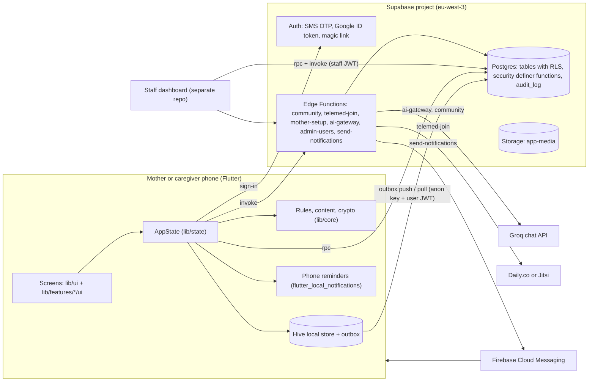
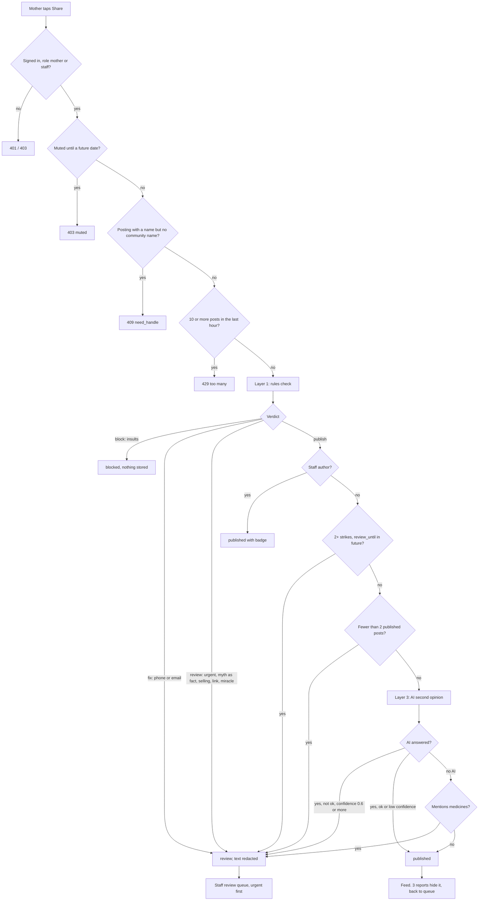
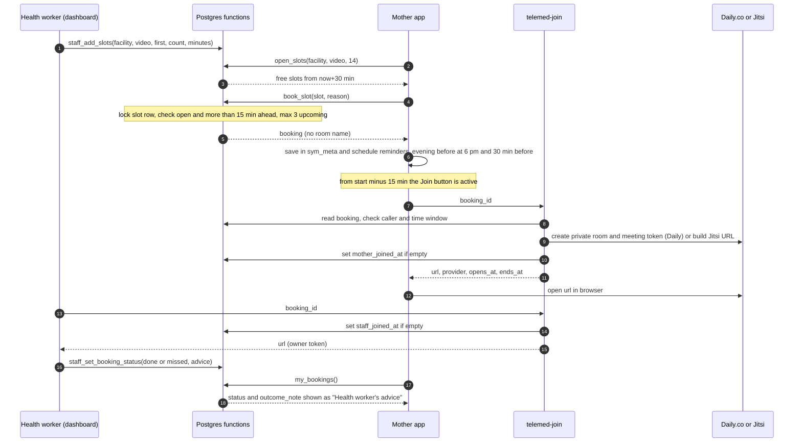

# Safari ya Mama: Technical Requirements and Design (TRD)

| | |
|---|---|
| Scope | The Flutter app in this repository and the server parts in `supabase/` |
| Date | 7 November 2026 |
| Related | [PRD.md](PRD.md) (what and why) · [USER_FLOWS.md](USER_FLOWS.md) · [BACKEND_SCHEMA.md](BACKEND_SCHEMA.md) (tables, enums, server functions) |

Readers: future developers and the dashboard team. Everything here is taken from the code. Gaps are marked
**to be decided**.

---

## 1. Architecture



Key points:
- The phone holds the mother's full record. The server is the backup and the link to her clinic.
- The app ships only the **anon (publishable) key**. Every server call carries the user's JWT. The service
  role key exists only inside Edge Functions.
- Without `SUPABASE_URL` and `SUPABASE_ANON_KEY` the app is an offline demo: nothing leaves the phone.

---

## 2. App layers and folder structure

| Folder | Holds | Notes |
|---|---|---|
| `lib/main.dart` | Start-up: Hive, content manifest, `LocalStore`, Supabase client, `AppState`, `ProviderScope` | Web demo query params `?demo=` with `pregnant`, `baby`, `twins` or `caregiver`, `&lang=sw`, `&a11y=1` (offline demo only) |
| `lib/config.dart` | Build-time configuration (`--dart-define`) | See section 13 |
| `lib/app/` | `app.dart` (app root, sync timer, lifecycle), `router.dart` (GoRouter routes and guards), `providers.dart` (Riverpod) | |
| `lib/core/` | Pure logic and shared UI: `rules.dart` (warning levels), `content.dart`, `lessons.g.dart`, `assistant.g.dart`, `first_aid.dart`, `body_check.dart`, `note_share.dart` (AES-GCM), `record_proof.dart`, `tx.dart` (bilingual text), `theme/` (design tokens), `widgets/` (shared widgets incl. `emergency_shortcut.dart`, `offline_indicator.dart`) | Do not edit `*.g.dart` (generated) |
| `lib/data/` | `local_store.dart` (Hive), `sync_service.dart` (outbox), `remote.dart` (Supabase behind `RemoteApi`), `reminders.dart`, `push.dart`, `voice.dart`, `ai_client.dart`, `google_auth.dart` | `RemoteApi` is an interface so tests use a fake |
| `lib/state/` | `app_state.dart` (the mother's whole record and actions), `app_scope.dart`, `demo_seed.dart` | |
| `lib/ui/` | Older screens (`ui/screens/*`), `theme.dart`, `widgets.dart`, `journey.dart`, `content_widgets.dart` | |
| `lib/features/<feature>/` | **Feature-first** code: `domain/` (pure rules and models), `data/` (server calls, cache), `ui/` (screens and widgets) | Today: `community`, `telemedicine` |

### Convention for new features
- New features go into `lib/features/<feature>/{domain,data,ui}`. `domain` has no Flutter or network imports
  where possible, so it can be unit-tested. `data` talks to `RemoteApi` and `LocalStore`. `ui` holds screens.
- A feature service hangs off `AppState` (for example `s.community`, `s.bookings`) so screens reach it with
  `context.app` / `context.appRead`.
- Older code in `lib/ui/screens` stays where it is until it is touched for other reasons (moving it is
  **to be decided**).

```
lib/features/
  community/
    domain/community_check.dart      shared content rules (Dart twin of check.ts)
    data/community_service.dart      feed, thread, post, names, report, helpful, offline cache
    ui/community_screen.dart, compose_post_screen.dart, post_screen.dart,
       post_card.dart, post_as.dart, community_name_screen.dart
  telemedicine/
    data/booking_service.dart        slots, book, cancel, my bookings cache, join link
    ui/appointments_screen.dart, book_screen.dart, booking_screen.dart, booking_format.dart
```

---

## 3. State and navigation

### State
- **`AppState`** (`ChangeNotifier`) holds the mother's record and all actions. Every write goes to the local
  store first, then the outbox.
- **Riverpod:** `appStateProvider` (a `ChangeNotifierProvider`, overridden in `main()` and in tests with an
  in-memory store) and `routerProvider` (one `GoRouter` for the app's lifetime).
- **`AppScope`** (`InheritedNotifier`) puts the same `AppState` in the widget tree: `context.app` rebuilds on
  change, `context.appRead` does not.

### Navigation (`lib/app/router.dart`)
- **`StatefulShellRoute.indexedStack`** with 5 branches (Home, My Care, MamaBot, Community, Learn). Each tab has
  its own navigator and back stack.
- Full-attention screens sit on the root navigator: `/emergency`, `/emergency/contacts`, `/doctor-note`,
  `/notifications`, `/profile`.
- Before the shell: `/welcome`, `/signin`, `/onboarding`, `/demo`, `/lock`, `/caregiver`, `/caregiver/join`.
- **Guards are one-way doors**: once a guard passes, Back can never re-enter the old state. Order:
  1. `/emergency` and `/emergency/contacts` are always open (before sign-in, on the lock screen).
  2. Locked → only `/lock`.
  3. Caregiver → only `/caregiver`.
  4. Not onboarded: `/caregiver/join` and `/demo` allowed; if a server exists and she is not signed in →
     `/welcome` or `/signin`; signed in → `/onboarding`.
  5. Onboarded but signed out (server configured) → `/signin`.
  6. Onboarded → pre-onboarding routes redirect to `/home`.
- When the app goes to the background and a PIN is set, `closeAllTabScreens()` pops every tab, then `lock()`.

---

## 4. Offline sync

Source: `lib/data/local_store.dart`, `lib/data/sync_service.dart`.

| Rule | Detail |
|---|---|
| Local first | Every record is stored in Hive with the same column names as its database row and a phone-made UUID. Each save writes the row and an outbox entry. |
| Boxes | `sym_meta` (settings and caches), `sym_outbox`, `sym_dead` (dead letters), one `sym_<table>` per synced table |
| Synced tables | `profiles`, `consents`, `pregnancies`, `babies`, `checkins`, `bp_readings`, `growth_measures`, `feeds`, `milestones`, `vaccine_doses`, `appointments`, `medications`, `journal_entries`, `visit_questions`, `birth_plans`, `lesson_views` |
| Event tables | `checkins`, `bp_readings`, `growth_measures`, `feeds`, `consents`: insert-only, duplicates ignored (a resend does nothing) |
| Editable tables | upsert and merge; the server's `*_touch` trigger keeps the newer `updated_at` |
| Order | Profile first, then oldest first, batches of up to 50 rows per table and operation |
| Errors | Network errors retry with backoff 30 s, 2 min, 10 min, then hourly. Permanent errors (validation, permission) are retried row by row so one bad row does not block others (e.g. a red check-in); rows that still fail go to the dead-letter list shown in Profile → Sync. |
| Pull | Rows changed since the last cursor per table (`updated_at`, `created_at`, or `viewed_at`); the server's `server_level` is kept. Server-owned columns (`edd`, `server_level`, `created_at`) are never sent. |
| When | On app open, every 60 seconds while open, on resume, and after sign-in. |
| First sign-in | Pull first, then merge: a phone's unsynced pregnancy is remapped onto the active server pregnancy; unsynced babies onto server babies born the same day, in birth order. Then push. |
| Not in the outbox | Community and bookings are online-only actions through server functions. The last feed (`community_cache`), her community name (`community_handle`) and her bookings (`bookings`) are cached in `sym_meta` for offline reading and reminders. |

The full sync contract is in [BACKEND_SCHEMA.md](BACKEND_SCHEMA.md).

---

## 5. Authentication

| Method | App code | Server |
|---|---|---|
| SMS code | `AppState.sendCode` / `verifyCode`; numbers starting `0` become `+255…` | Supabase Auth phone OTP (6 digits). Needs an SMS provider (**not configured yet**). |
| Clinic setup code | `AppState.redeemSetupCode` → `RemoteApi.signInWithSetupCode` | `mother-setup` `redeem` returns a magic-link `token_hash`; the app calls `auth.verifyOTP(type: magiclink)` |
| Google | `GoogleAuth.idToken()` (native picker) → `auth.signInWithIdToken` | Supabase Auth Google provider with the Web client ID |
| Caregiver | Own phone number + SMS, then `accept_caregiver_invite` with the mother's 6-digit code | SQL functions in `20261105010000_caregivers_proof_push_hardening.sql` |
| Staff / admins | Dashboard only | Email + password or invite (`admin-users`); admins need MFA (`aal2`) |

After sign-in (`_afterSignIn`): refresh facilities → pull and adopt server record → save profile → add the
facility consent if she chose it before sign-in → sync → refresh bookings → if records exist, mark onboarded.

---

## 6. Server

### 6.1 Tables
See [BACKEND_SCHEMA.md](BACKEND_SCHEMA.md). New tables in `20261106010000_community_bookings.sql`:

| Table | Purpose | Access |
|---|---|---|
| `community_profiles` | Community name (`handle`), look-alike key (`handle_key`, unique), `handle_changed_at`, `strikes`, `review_until`, `muted_until` | No direct access; Edge Function and functions only |
| `community_posts` | Posts and replies (`parent_id`), topic, body, `anonymous`, stage, `status` (published / review / hidden / removed), `urgent`, `reasons[]`, `facts[]`, `ai`, `staff_post`, `health_note`, checked by/at, counters | Select policy: author, staff, platform admin; but table grants revoked from `anon` and `authenticated`, so only functions read it |
| `community_reports` | One report per mother per post, with reason | Functions only |
| `community_helpful` | One "helpful" per mother per post | Functions only |
| `booking_slots` | Facility, staff, start, minutes (5–120), mode (clinic / video), status (open / booked / cancelled) | Functions only |
| `bookings` | Slot, mother, facility, staff, start, minutes, mode, reason (≤300), status (booked / cancelled / done / missed), random `room`, `outcome_note` (≤1000), join times, cancelled by | Functions only; `room` returned only by `telemed-join` |

### 6.2 SQL functions used by the app (new)

| Function | Caller | Returns / does |
|---|---|---|
| `community_feed(p_topic, p_before, p_limit)` | Signed in | Published top-level posts plus her own not-removed ones, newest first, max 50 |
| `community_thread(p_post)` | Signed in | `{post, replies}` |
| `report_community_post(p_post, p_reason)` | Signed in, not author | Records report; 3 reports hide a post unless staff wrote it or a health worker checked it |
| `toggle_community_helpful(p_post)` | Signed in | New on/off state |
| `delete_my_community_post(p_post)` | Author | Sets `removed` |
| `my_community_profile()` | Signed in | `{handle, can_change_at, strikes, review_until, muted_until}` (only future dates) |
| `open_slots(p_facility, p_mode, p_days=14)` | Signed in | Open slots from now+30 min to now+`p_days` (1–60) at an active facility |
| `book_slot(p_slot, p_reason)` | Role `mother` | Locks the slot (`for update`); errors `taken` (P0001) or `too_many` (P0001); returns the booking |
| `cancel_booking(p_booking)` | Mother or facility staff | Cancels; slot reopens if > 30 min ahead |
| `my_bookings()` | Signed in | Her last 50 bookings (no room name) |

Dashboard-only functions (`community_review_queue`, `moderate_community_post`, `staff_add_slots`,
`staff_cancel_slot`, `staff_bookings`, `staff_set_booking_status`, `community_kpis`, `booking_kpis`) are listed
in PRD section 7 and BACKEND_SCHEMA.md.

### 6.3 Edge Functions: request and response contracts

All accept `POST` with JSON and answer CORS `OPTIONS`.

#### `community` (verify JWT on)
| Request | Response |
|---|---|
| `{action:"post", body, topic, parent_id?, anonymous:bool, stage?:{kind:"pregnant"\|"baby", value:int}}` | `200 {id, status:"published"\|"review", urgent, facts:[ids], reasons:[codes]}` |
| | `200 {status:"blocked", reasons}`: insults, nothing stored |
| | `409 {error:"need_handle"}`: chose her name but has none |
| | `403 {error:"muted", until}`: 4 strikes |
| | `429` more than 10 posts in the last hour · `400` bad body, length outside 2–1000, or parent not an open top-level post · `401` not signed in · `403` not a mother or staff |
| `{action:"handle_check", handle}` | `{ok:true}` or `{ok:false, problem:"length"\|"chars"\|"start"\|"digits"\|"reserved"\|"offensive"\|"taken"}` |
| `{action:"handle", handle}` | `{handle}` · `400 {error:<rule>}` · `409 {error:"taken"}` · `409 {error:"too_soon", can_change_at}` |

Reason codes: `urgent`, `privacy`, `abuse`, `selling`, `miracle`, `myth:<id>`, `fact:<id>`, `new`, `strikes`,
`ai:<label>`, `unchecked-medical`.
Secrets: `GROQ_API_KEY` (optional), `GROQ_MODEL` (optional).

#### `telemed-join` (verify JWT on)
| Request | Response |
|---|---|
| `{booking_id}` | `200 {url, provider:"daily"\|"jitsi", opens_at, ends_at}` |
| | `425 {error:"too_early", opens_at}` · `410 {error:"ended"}` (not booked, or past the window) · `403 {error:"not your appointment"}` · `404 {error:"not found"}` (missing or not video) · `401` |

Allowed callers: the booking's mother; or a `health_worker` / `facility_admin` with an active
`staff_assignments` row for that facility. Window: start − 15 min to start + minutes + 30 min.
Secrets: `DAILY_API_KEY`, `DAILY_DOMAIN` (recommended), `JITSI_BASE` (optional).

#### `mother-setup` (deploy with `--no-verify-jwt`)
| Request | Caller | Response |
|---|---|---|
| `{action:"create", phone, name?, facility_id?}` | Staff JWT (health worker / facility admin must be assigned to the facility) | `{code, expires_at}` · 400 bad phone · 403 · 409 phone belongs to staff or helper |
| `{action:"redeem", code}` | App, before sign-in | `{token_hash, type:"magiclink"}` · `400 "this code is wrong, used or expired"` · `429` after 10 failures per hour per client IP |

#### `ai-gateway` (verify JWT on)
| Request | Response |
|---|---|
| `{task:"assistant", lang:"sw"\|"en", input, context:{stage:"pregnant"\|"postpartum"\|"baby"}}` | `{text, label, urgent:false}` · urgent words: `{text:<safety message>, label, urgent:true, action:"emergency"}` · `{unavailable:true}` (no key, timeout, error, empty/cut-off) · `429 {error:"daily limit"}` (30 / 24 h) · `401` |

Secrets: `GROQ_API_KEY`, `GROQ_MODEL` (default `llama-3.3-70b-versatile`).

#### `admin-users` (dashboard; verify JWT on)
Actions `create`, `resend_invite`, `reset_password`, `deactivate`, `reactivate`, `create_facility`. Permission is
decided in Postgres with the caller's JWT (`can_manage_account`, `can_manage_user`). Temporary passwords are
returned once and never stored or logged. Secret: `DASHBOARD_URL` (optional).

#### `send-notifications` (cron only; `--no-verify-jwt`, bearer `CRON_SECRET`)
Sends queued pushes from `notification_queue` with FCM HTTP v1. Fixed template texts only. Secrets:
`FCM_SERVICE_ACCOUNT`, `CRON_SECRET`. **Not deployed.**

---

## 7. Community moderation algorithm

Shared rules: `supabase/functions/community/rules.json` (server) is a byte-for-byte copy of
`assets/content/community_rules.json` (app); `test/community_test.dart` checks they are identical. Matching code:
`check.ts` (server) and `lib/features/community/domain/community_check.dart` (app).

**Text matching.** Text is lower-cased, punctuation removed, repeated letters shortened ("soooo" → "soo").
A term matches at the start of a word ("stop" matches "stopped", not "nonstop"). A myth matches when every
group in `all` has a term in the **same sentence** and no `unless` term is there. A sentence is a question if
it contains `?` or starts with a question word from `question_starts`.



Notes on the diagram:
- For staff posts, insults are still blocked; any other verdict publishes at once.
- Strike and new-member checks run for non-staff even when layer 1 already chose review (they add reasons).
- The AI is called only when nothing so far has held the post.

### Decision table (layer 1 verdict, strongest first)

| Match in text | Reason | Verdict | Stored? | Shown to others? | What she sees |
|---|---|---|---|---|---|
| Abuse word | `abuse` | block | No | No | "Please write kindly" (Share disabled) |
| Phone (9+ digits) or email | `privacy` | fix | Yes, redacted, `review` | After a health worker checks | "Please remove phone numbers and email addresses" (Share disabled) |
| Danger sign | `urgent` | review + urgent | Yes | After check | Red card + "Get help now" → Emergency |
| Myth stated as fact | `myth:<id>` | review | Yes | After check | "A health worker will check this" + fact card |
| Selling word or link | `selling` | review | Yes | After check | "A health worker will check this" |
| Miracle cure word | `miracle` | review | Yes | After check | "A health worker will check this" |
| Myth asked as a question | `fact:<id>` | publish | Yes | Yes (if later layers allow), with "Checked fact" | Fact card |
| Nothing | — | publish | Yes | Yes (if later layers allow) | — |

### Moderation actions (`moderate_community_post`)

| Action | New status | Note | Strike | Urgent flag |
|---|---|---|---|---|
| `publish` | published | sets note if given | — | cleared |
| `note` | published | sets / clears note | — | cleared |
| `hide` | hidden | sets note if given | — | cleared |
| `remove` | removed | sets note if given | — | kept |
| `remove_strike` | removed | sets note if given | +1; at 2 → `review_until = now + 30 days`; at 4 → `muted_until = now + 30 days` | kept |

Every action writes `audit_log` (`community_<action>`, post id). Strikes never decrease in the current code
(**to be decided**).

### Community names
`checkHandle` order: `length` → `chars` → `start` → `digits` → `reserved` → `offensive`. Then uniqueness on
`handle_key`: lower case, remove `_` and `.`, map `0→o 1→i l→i 3→e 4→a 5→s 7→t 8→b`. Offensive words of 5+
letters match anywhere in the key; shorter ones only as the whole key, a prefix or a suffix. The app checks
locally while she types, then asks the server (`handle_check`) 0.5 s after she stops typing.

---

## 8. Telemedicine design



Design choices:
- The room name is a random 64-hex string created by the database and returned only by `telemed-join`, close
  to the time. `_booking_row` never includes it.
- Daily rooms: `privacy: private`, `exp` = window end, `eject_at_room_exp`, `max_participants: 4`, prejoin UI and
  chat on. One meeting token per person; staff tokens have `is_owner: true`. If the room already exists (HTTP 400)
  the function only issues a new token.
- Display names: staff use their `display_name`; the mother is always "Mama".
- Nothing about the call content is stored. Only the first join time of each side.
- The app checks the window locally (`Booking.canJoin`) to show the button, but the server decides.
- The app refreshes bookings on open, on resume and after sign-in; reminders are re-planned whenever bookings change.

---

## 9. Security and privacy

| Control | Where |
|---|---|
| Anon key only in the app; service role only in Edge Functions | `lib/config.dart`, `supabase/functions/*` |
| Row-level security on every table | Migrations; new community/booking tables also have grants revoked from `anon` and `authenticated` |
| `security definer` functions with `set search_path = public` and an explicit role check at the top (`is_staff`, `is_platform_admin`, `staff_of`, `my_role`) | All new functions |
| Execute rights revoked from `public, anon`, granted to `authenticated` only for the listed functions; helpers (`_community_row`, `_booking_row`, `_small`) revoked from everyone | End of `20261106010000_community_bookings.sql` |
| Append-only `audit_log` | Moderation actions, setup codes, Doctor's Note openings, record checks, admin actions |
| Consent per facility and kind; staff see a mother only while `sharing_on(mother, facility)` | `consents`, `can_read_mother`, KPI functions |
| Community posts never return `author_id`; `urgent` returned only to the author | `_community_row` |
| Small numbers hidden (under 5 → null) | `_small`, `admin_kpis`, `programme_kpis` |
| No personal data in logs or AI | `ai-gateway` and `community` send only text (and stage) to Groq; nothing logged; `ai_usage` stores only who and when |
| Doctor's Note end-to-end encrypted (AES-256-GCM, key only in QR) | `lib/core/note_share.dart`, `note_shares` |
| Setup codes: only SHA-256 hash stored; rate limit per client | `mother-setup` |
| Push and reminders carry no health data; lock screen generic by default | `push.dart`, `reminders.dart`, `send-notifications` |
| Shared phones: PIN, screens closed on background, journal owner-only | `app.dart`, `router.dart`, journal policy |
| Admin powers need MFA (`aal2`); turn on "Leaked password protection" | `20261106000100_roles_permissions.sql`, `supabase/README.md` |

Secrets are never put in git or chat. Set them with `supabase secrets set` in a terminal.

---

## 10. Notifications

| Kind | How | Content |
|---|---|---|
| Phone reminders | `flutter_local_notifications`, planned by the pure function `plannedReminders(AppState)` | Daily check; tablet/medicine; movements (from 20 weeks); evening before visits and vaccines (18:00, up to 4 visits); bookings: evening before at 18:00 (up to 3) and 30 min before a video call |
| Lock-screen privacy | Unless "Show details" is on, every reminder shows only the generic text | |
| Push | FCM token registered with `register_push_token`; server sends from `notification_queue` via `send-notifications` | Template only (e.g. "You have a reminder"); staff template for unacknowledged red alerts |
| In-app | Notifications screen and bell badge (unread reminders) | |

Reminders are re-synced on app open, on resume, and when bookings change (`onBookingsChanged`).

---

## 11. AI

| Use | Model | Safety |
|---|---|---|
| MamaBot answers (`ai-gateway`) | Groq, `GROQ_MODEL` or `llama-3.3-70b-versatile`, temperature 0.3, max 400 tokens, 12 s timeout (app gives up at 15 s) | Urgent words checked in the app and again on the server; urgent questions never reach the model. System prompt forbids diagnosis, prescribing, and "you are fine". Answer labelled. Fallback to scripted answers. |
| Community second opinion (`community`) | Same key and model, temperature 0, max 120 tokens, JSON output, 8 s timeout | Can only hold a post (labels misinformation, harmful, spam, abuse at confidence ≥ 0.6). Never publishes what rules held. No AI → medicine posts held. |

AI never sets or changes a warning level. Keep the app's urgent intents (`assistant.g.dart`) and the
server's `URGENT_WORDS` in step by hand (**no automated parity test yet**).

---

## 12. Testing

| What | Command | Current result |
|---|---|---|
| App tests (unit + widget) | `flutter test` | **128 passed** (7 Nov 2026) |
| Static analysis | `flutter analyze` | — |
| Warning-rule parity (phone vs server cases) | part of `flutter test` (`test/rules_parity_test.dart`, fixture `test/fixtures/rules_cases.json`) | Passing |
| Community rules, server side | `node supabase/tests/community_check.test.ts` | 31 content cases + 25 name checks passed |
| Community rules, app side | part of `flutter test` (`test/community_test.dart`, fixture `test/fixtures/community_cases.json`) | Passing; also checks the two rules files are identical |
| Server permissions | Run `supabase/tests/permissions.sql` in the SQL editor (one transaction, rolls back) | 97 role × action checks, passing 5 Nov 2026 |
| Screenshots | `flutter test test_screens/audit_test.dart --update-goldens` (writes `test_screens/shots/`); also `new_features_shots_test.dart`, `website_shots_test.dart` | — |

Test files in `test/`: `ai_and_proof_test`, `app_state_test`, `bookings_test`, `child_side_test`,
`community_test`, `drawer_test`, `full_version_test`, `lesson_page_test`, `new_features_test`,
`review_fixes_test`, `rules_parity_test`, `rules_test`, `signin_required_test`, `sync_test`, `twins_test`,
`widget_flow_test`, with `fakes.dart` (fake `RemoteApi`) and `fixtures/`.

When changing community rules: edit `supabase/functions/community/rules.json`, copy it to
`assets/content/community_rules.json`, add cases to `test/fixtures/community_cases.json`, run both tests.

---

## 13. Configuration

### App (`--dart-define`)

| Name | Purpose | Secret? |
|---|---|---|
| `SUPABASE_URL` | Server address; without it the app is an offline demo | No |
| `SUPABASE_ANON_KEY` | Publishable key | No |
| `GOOGLE_WEB_CLIENT_ID` | Google sign-in (Android, and Supabase Auth → Google) | No |
| `GOOGLE_IOS_CLIENT_ID` | Google sign-in on iOS | No |
| `FCM_API_KEY`, `FCM_APP_ID`, `FCM_SENDER_ID`, `FCM_PROJECT_ID` | Push registration | No (public Firebase IDs) |
| `DEMO_PICKER` | `true` shows the demo picker (preview builds only) | No |

### Server (`supabase secrets set`; names only)

| Name | Used by |
|---|---|
| `GROQ_API_KEY`, `GROQ_MODEL` | `ai-gateway`, `community` |
| `DAILY_API_KEY`, `DAILY_DOMAIN`, `JITSI_BASE` | `telemed-join` |
| `FCM_SERVICE_ACCOUNT`, `CRON_SECRET` | `send-notifications` (and Vault secret `cron_secret` for the cron job) |
| `DASHBOARD_URL` | `admin-users` |
| `SUPABASE_URL`, `SUPABASE_SERVICE_ROLE_KEY`, `SUPABASE_ANON_KEY` | Provided by Supabase to every function |

---

## 14. Deployment

```bash
# once
supabase login
supabase link --project-ref qrkzzptfpcotirbvvmke

# database: applies migrations/ not yet on the project (in name order)
supabase db push

# functions
supabase functions deploy ai-gateway
supabase functions deploy community
supabase functions deploy telemed-join
supabase functions deploy mother-setup --no-verify-jwt
supabase functions deploy send-notifications --no-verify-jwt   # optional push

# secrets (type in your own terminal)
supabase secrets set GROQ_API_KEY=...
supabase secrets set DAILY_API_KEY=... DAILY_DOMAIN=...
```

Then: schedule `send-notifications` with `pg_cron` + `pg_net` (SQL in `supabase/README.md`); run
`tests/permissions.sql`; configure Auth (SMS provider, Google provider, redirect URLs, leaked-password
protection).

App:
```bash
flutter pub get
flutter analyze && flutter test
flutter build appbundle --release --dart-define=SUPABASE_URL=... --dart-define=SUPABASE_ANON_KEY=... \
  --dart-define=GOOGLE_WEB_CLIENT_ID=... --dart-define=FCM_API_KEY=... (etc.)
```

Web demo: `flutter build web`, then open with `?demo=pregnant` or `?demo=baby` (`&lang=sw`, `&a11y=1`).

---

## 15. Performance and low bandwidth

- Everything she needs daily runs from the phone: rules, lessons, first aid pictures and animations,
  scripted MamaBot, reminders, Emergency help.
- Sync sends small JSON batches (up to 50 rows) and only rows changed since the last cursor.
- Community feed: 30 posts per page; the first unfiltered page is cached for offline reading. Replies load per thread.
- Name checks wait 0.5 s after typing stops before calling the server.
- Video calls run in the phone's browser, not inside the app (no video SDK in the app bundle).
- Push adds about 1.5 MB to the Android app (`lib/data/push.dart`); it is optional.
- Content pictures: WebP, 1200×900, under 150 KB each (manifest contract), once the app downloads them.
- "Low data mode" exists as a setting but does not yet change sync or media behaviour (**to be decided**).
