# Safari ya Mama: User Flows

| | |
|---|---|
| Date | 7 November 2026 |
| Related | [PRD.md](PRD.md) (requirement IDs used below) · [TRD.md](TRD.md) · [BACKEND_SCHEMA.md](BACKEND_SCHEMA.md) |

Each flow has: short steps, a diagram, and edge cases. Screen and button names are the English texts in the
app (every one also exists in Kiswahili). Server parts marked "pending" are not live yet (PRD section 10).

Contents
1. First launch and sign-in
2. Daily check and emergency
3. Mothers' circle (community)
4. Appointments and video calls (telemedicine)
5. Caregiver joins
6. Staff dashboard flows

---

## 1. First launch and sign-in

Requirements: ACC-01 to ACC-08.

**Steps**
1. Welcome screen: brand, language choice, three buttons: **Get started**, **I already use Safari ya Mama**,
   **I help a mother (partner or family)**. Emergency help is reachable.
2. Get started or I already use → **Sign in** (when the app has a server). Three ways:
   - **Continue with Google** (only in builds with Google client IDs).
   - **SMS code**: phone number (07xx… becomes +2557xx…) → "Send me a code" → 6-digit code → Sign in.
   - **Code from clinic**: the 8-digit code staff gave her → Sign in.
3. After sign-in the app pulls her server records.
   - **Returning mother** (pregnancy or baby already on the server) → Home.
   - **New mother** → setup questions: first name → pregnant or baby born, with dates → emergency contacts
     and clinic → consent switches (all off) → optional 4-digit PIN → Start → Home.
4. Without a server (offline demo) Get started goes straight to the setup questions.

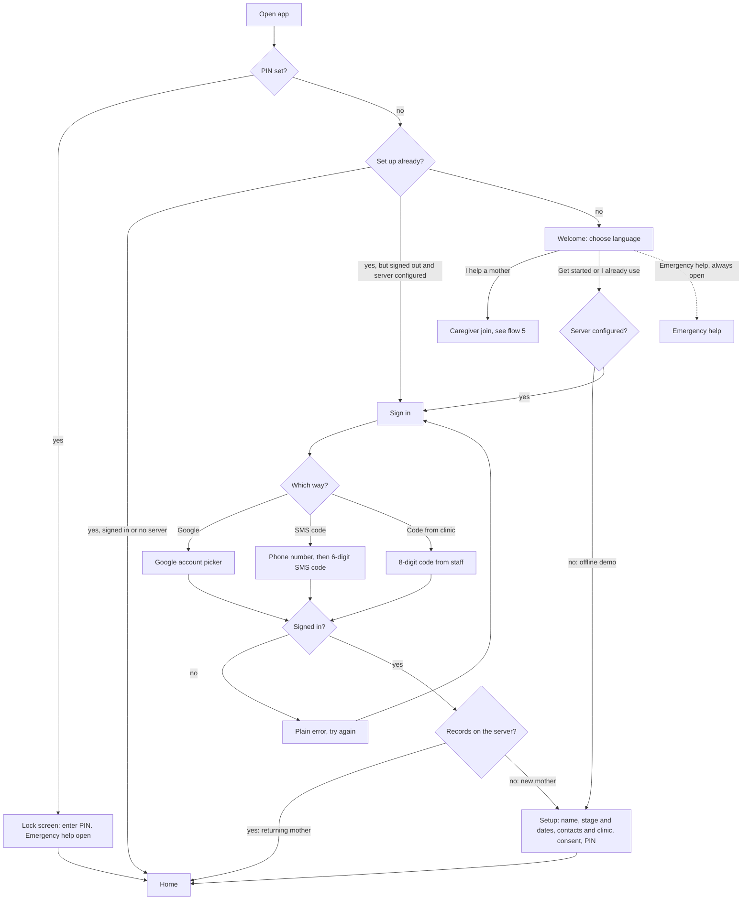

**Edge cases**
- She cancels the Google window: nothing happens, she stays on Sign in.
- Wrong, used or expired clinic code: "this code is wrong, used or expired". After 10 failures in an hour from
  the same network: "too many tries, wait an hour". (Clinic codes are **pending** on the server.)
- No signal right after sign-in: she continues; the normal sync merges her records later.
- A phone number that belongs to a staff or helper account cannot get a clinic code.
- She set up the app before sign-in was required: on next open she is sent to Sign in; her phone records are
  merged with the server, not duplicated.
- Back from Home never returns to Welcome or Sign in (one-way doors).

---

## 2. Daily check and emergency

Requirements: CHK-01 to CHK-03, EMR-01, EMR-02.

**Steps**
1. Home → "Today's check" (or MamaBot → Check symptoms).
2. Answer: how she feels, danger signs, baby movements (from 20 weeks). After birth: her signs, then each
   baby's signs in three coloured steps and feeding.
3. The phone decides the level with the fixed rules (works offline).
4. Result:
   - **Green**: keep going, daily care tips.
   - **Amber**: contact a health worker today (within 24 hours).
   - **Red**: go to a health facility now, with **Emergency help**.
5. The check is saved and synced later. If she shares with her clinic, staff can see it; the server may raise
   the level (`server_level`), and the app then shows the higher level.

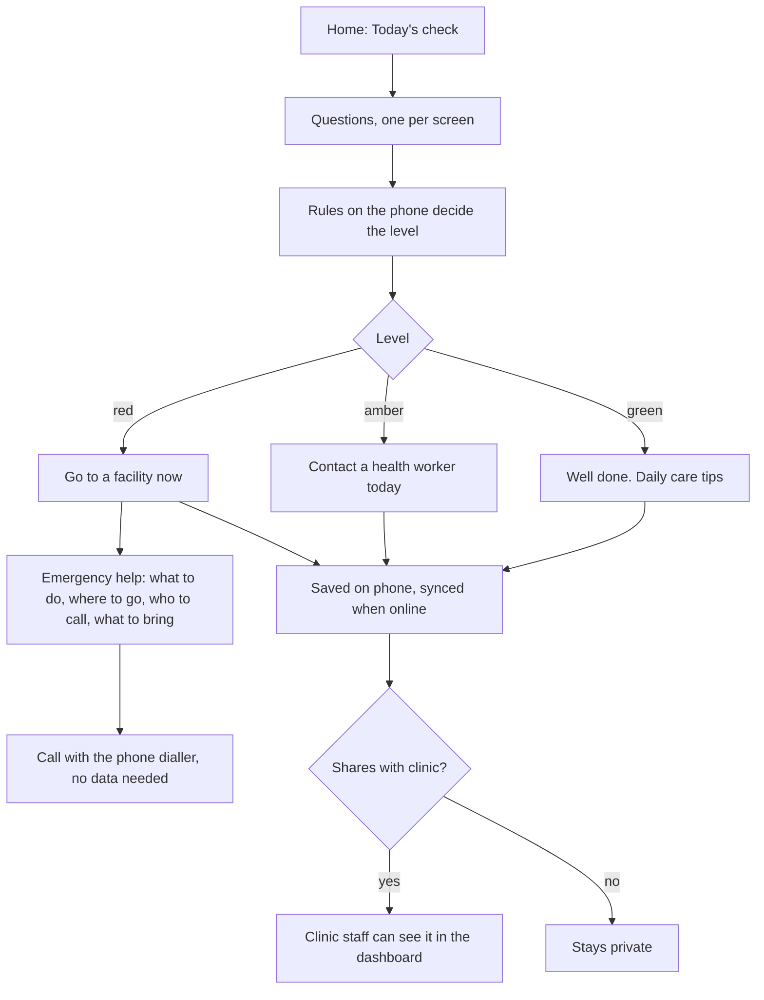

**Edge cases**
- No signal: result and Emergency help still work; the outbox sends the check later.
- Twins: a sign in any baby counts; each baby's answers are kept separately.
- 4 or more everyday (green-step) baby signs together give amber.
- Emergency help is also open from the lock screen and before sign-in.

---

## 3. Mothers' circle (community)

Requirements: COM-01 to COM-20. Server part **pending** (migration and `community` function).

### 3.1 First post, anonymous

**Steps**
1. Community tab → "Share with mothers".
2. Choose a topic; type or speak the text.
3. "Who should other mothers see?" is already on **Anonymous mother** (default, remembered).
4. Share. Because it is one of her first posts, it waits for a health worker.
5. She sees "Thank you. A health worker will check it soon. Until then only you can see it." Her post shows in
   her feed with "Waiting for a health worker to check · only you can see it".

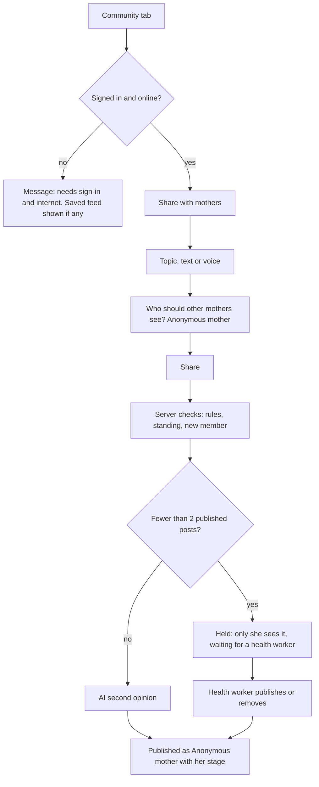

**Edge cases**
- No internet when sharing: "Not sent. Check your internet and try again." Text stays in the box.
- More than 10 posts in an hour: "You have shared a lot today. Please try again later."
- Over 1,000 characters: the text box stops at 1,000.

### 3.2 Choosing a community name

**Steps**
1. Tap "A community name" in the post screen, or "Choose a community name" on the Community tab.
2. Type a name, or tap one of 4 ideas (e.g. "MamaJasiri42").
3. The phone checks the rules at once. If they pass, the server checks it is free 0.5 s after she stops typing.
4. "This name is free." → Save this name.

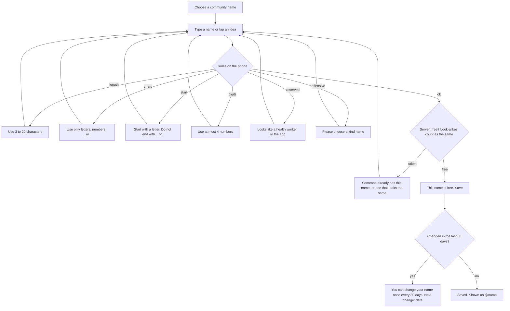

**Edge cases**
- Look-alikes: "Mama_Am1na" is taken if "MamaAmina" exists (1, i, l are one letter; `_` and `.` ignored).
- Offline during check or save: "Not saved. Check your internet and try again."
- Two mothers save the same name at the same moment: the database's unique key refuses the second ("taken").

### 3.3 Posting with her name

**Steps**
1. In "Who should other mothers see?" tap her **@name** (or "A community name" if she has none: the name screen
   opens first; backing out keeps Anonymous).
2. The choice is remembered for next time. Replies show one line: "Replying as @name · change".
3. Share. The post shows "@name · 28 weeks pregnant".

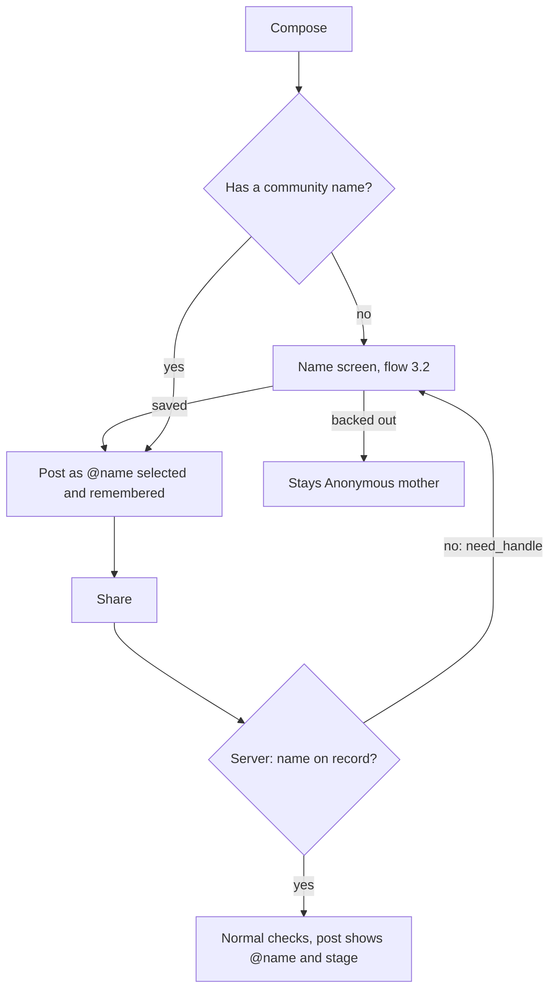

**Edge cases**
- Name saved on another phone but not this one: server answers `need_handle`; the name screen opens, then she
  taps Share again.
- Real name and phone are never shown in either choice.

### 3.4 Myth asked as a question vs stated as fact

**Steps**
1. She types. The phone runs the same rules as the server while she writes.
2. If a myth is **asked** ("Is it true I should stop iron?"), a "Checked fact" card appears; the post can be
   published with the card.
3. If a myth is **stated** ("Stop iron, it makes the baby big."), an amber card says a health worker will check
   it first; the fact card also shows.

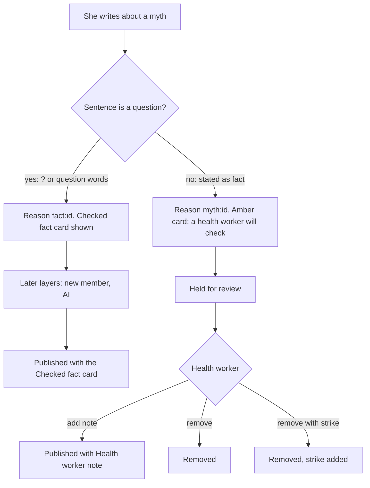

**Edge cases**
- "Don't stop taking iron" does not match the myth (`unless` words).
- A question can still be held if she is a new member, has 2+ strikes, or the AI flags it.

### 3.5 Danger sign in a post

**Steps**
1. While she types words like heavy bleeding or fits, a red card appears at once: "This sounds like a danger
   sign. Get help now. Do not wait for answers here." with **Get help now**.
2. If she still shares, the post is held, marked urgent, and goes to the top of the staff queue.
3. On her own post card she sees the danger warning and the **Get help now** button again.

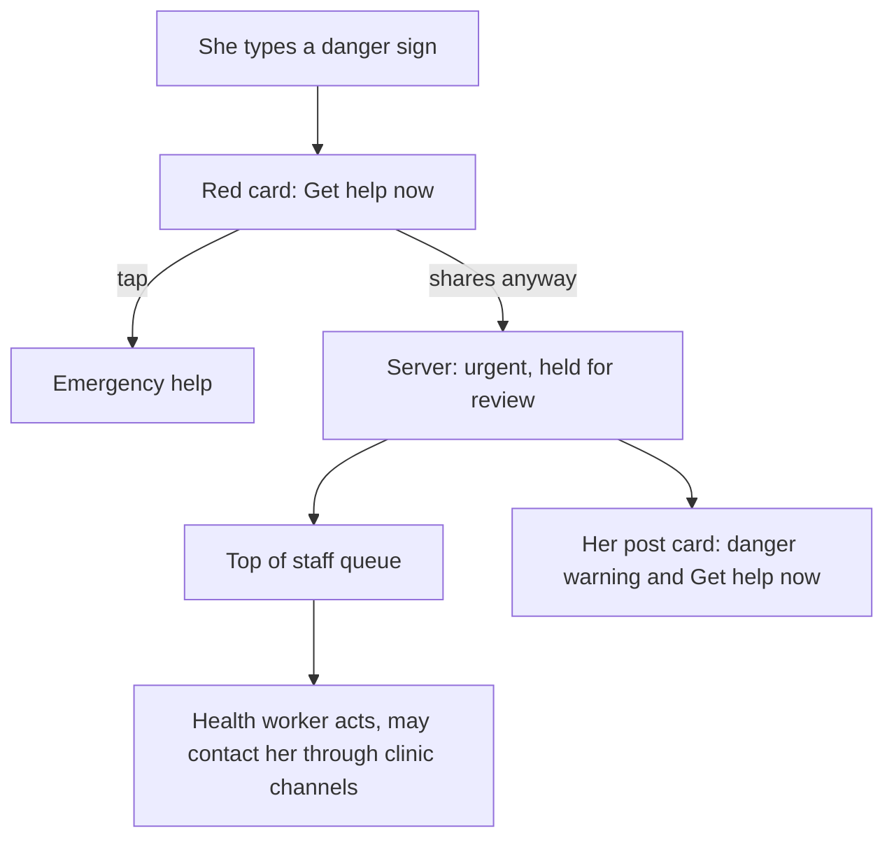

**Edge cases**
- Other mothers never see the urgent flag.
- How a health worker follows up outside the app is **to be decided** (the queue does not show her phone).

### 3.6 Reporting a post

**Steps**
1. On another mother's published post → More → Report → choose: wrong, unkind, selling, private, other.
2. "Thank you. A health worker will look at it."
3. When 3 different mothers have reported it, the post is hidden and goes to the staff queue.

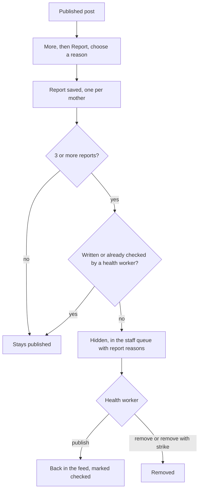

**Edge cases**
- She cannot report her own post. Reporting twice counts once.
- No internet: "No internet. Try again later."

### 3.7 Strikes and paused posting

**Steps**
1. A health worker removes a post "with strike".
2. At 2 strikes: all her posts wait for review for 30 days. The tab shows an amber card with the end date.
3. At 4 strikes: she cannot post for 30 days. The tab and the Share button explain it; she can still read and
   mark posts helpful.

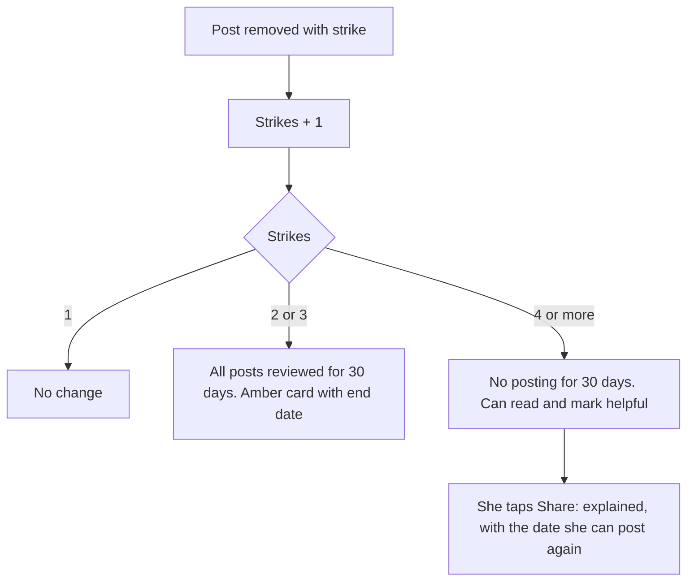

**Edge cases**
- Each further strike moves the end date to 30 days from that strike.
- Strikes do not go down over time in the current code (**to be decided**).

---

## 4. Appointments and video calls (telemedicine)

Requirements: TEL-01 to TEL-16. Server part **pending** (migration and `telemed-join`).

### 4.1 Booking a video call in 3 steps

**Steps**
1. Home → "See a health worker" (or side menu → Appointments → Book an appointment).
2. **Step 1, how to meet:** Video call or Visit the clinic (and her clinic, if not set or several). Note: "In an
   emergency, do not book: go now or open Emergency help."
3. **Step 2, day and time:** free times from 30 minutes ahead for 14 days → Next.
4. **Step 3, check and book:** summary, optional "What would you like to talk about?" → Book this time.
5. "You are booked. We will remind you the evening before." Home shows "Your next appointment".

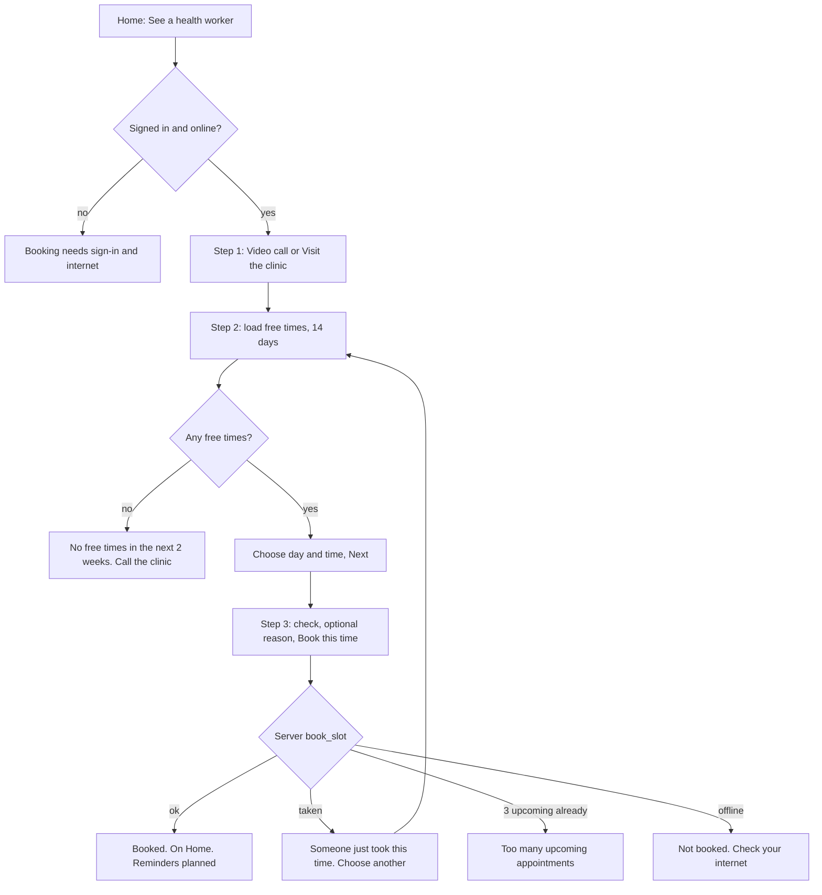

**Edge cases**
- Back inside the steps goes to the previous step, not out of booking.
- A slot within 15 minutes of starting cannot be booked.
- No clinics listed: "Connect to the internet once to see the clinics."

### 4.2 Reminders and the join window

**Steps**
1. Evening before at 18:00: "Video call tomorrow at 10:00" (or "Clinic appointment tomorrow at …").
2. 30 minutes before a video call: "Video call in 30 minutes. Find a quiet place."
3. The appointment screen shows "Before the call" tips. The Join button works from 15 minutes before the start.
4. Join → the app asks `telemed-join` for the link → the call opens in the browser.

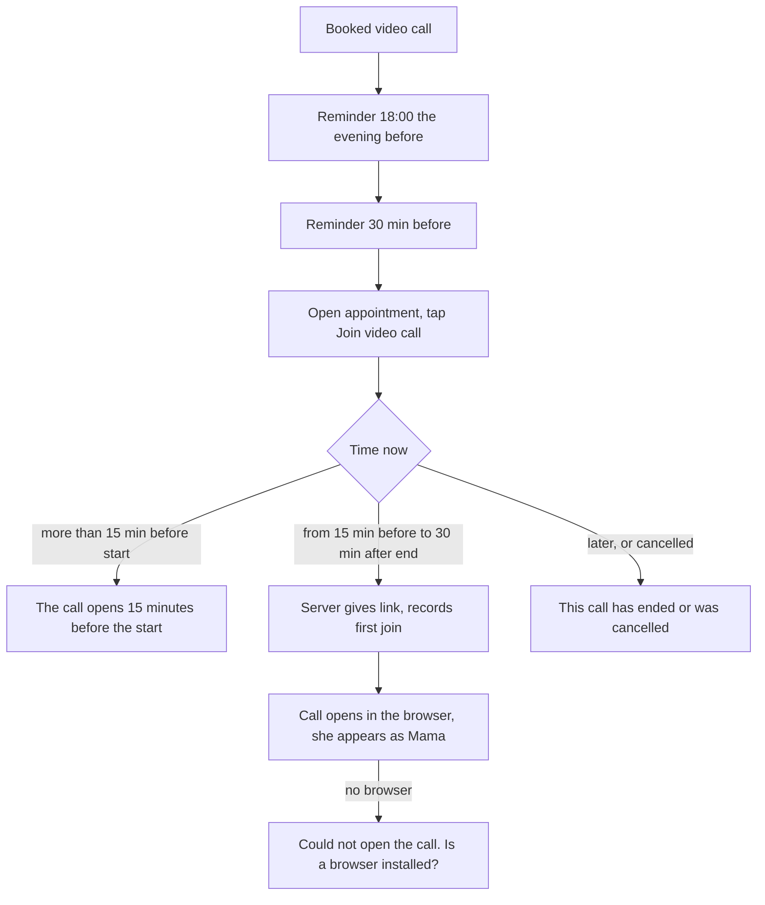

**Edge cases**
- Reminders are generic on the lock screen unless she turned on "Show details".
- Phone reminders off: no reminders; the booking still shows on Home.
- No signal at call time: "Could not join. Check your internet and try again." She can use "Call the clinic".

### 4.3 After the visit: advice

**Steps**
1. Staff mark the appointment **done** or **missed** and may write advice.
2. Next time her bookings refresh (app open, resume), the appointment shows the status and a
   "Health worker's advice" card, with "If you feel worse, do not wait: open Emergency help."

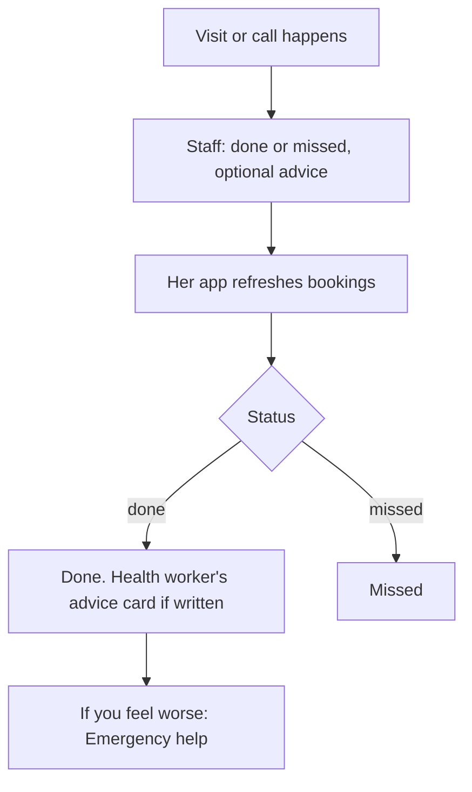

### 4.4 Cancelling

**Steps**
1. Appointment → Cancel appointment.
2. Status becomes Cancelled. The time opens again for other mothers if it is more than 30 minutes ahead.
3. Reminders for it are removed.

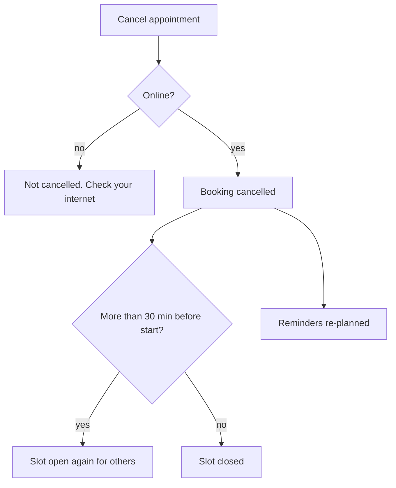

**Edge cases**
- Staff can also cancel a booking from the dashboard.
- Cancelling an appointment that is already done, missed or cancelled does nothing.

---

## 5. Caregiver joins

Requirements: SHR-04, SHR-05.

**Steps**
1. **Mother:** Profile → My helpers → choose relation and "Tell them when my check is red or orange" → Make a code
   (6 digits, valid 48 hours, once) → copy a message to send.
2. **Helper:** Welcome → "I help a mother (partner or family)" → first name → "Sign in with my phone number"
   (SMS) → "Code from the mother" → Join.
3. Helper's home: one card per mother: today's level and signs, last 7 days, next visit and vaccine, open alert
   (if allowed).
4. **Mother** can see who helps her and tap Stop.

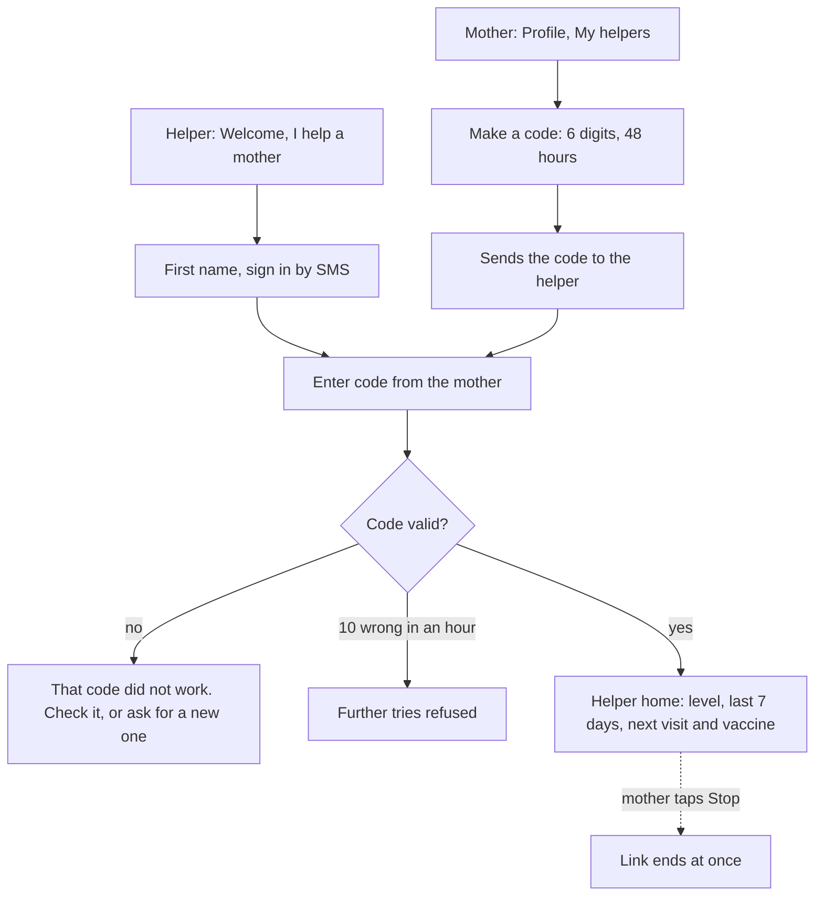

**Edge cases**
- At most 5 open codes per mother.
- Offline demo build: "a helper cannot join here".
- Helpers never see her journal, notes, questions or phone.

---

## 6. Staff dashboard flows

The dashboard is a separate repository; these flows show what it does with this server. Functions are listed in
[BACKEND_SCHEMA.md](BACKEND_SCHEMA.md).

### 6.1 Setting up a mother with a clinic code

**Steps**
1. Staff enter her phone number (and name, facility) → `mother-setup` `create`.
2. The dashboard shows the 8-digit code and its expiry (24 hours). Staff give it to her.
3. She signs in with "Code from clinic" (flow 1).

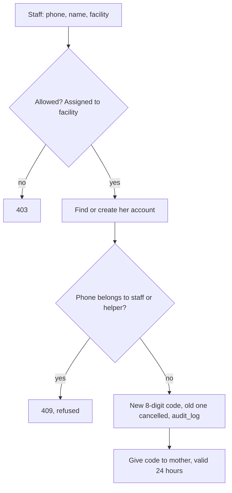

### 6.2 Moderation queue

**Steps**
1. Open the queue (`community_review_queue`): held and hidden posts, **urgent first**, then oldest. Each row shows
   the post, the parent post for replies, reasons, the AI label, and report reasons.
2. Choose an action: Publish · Add note (publishes) · Hide · Remove · Remove with strike.
3. The post leaves the queue. The action is written to the audit log.

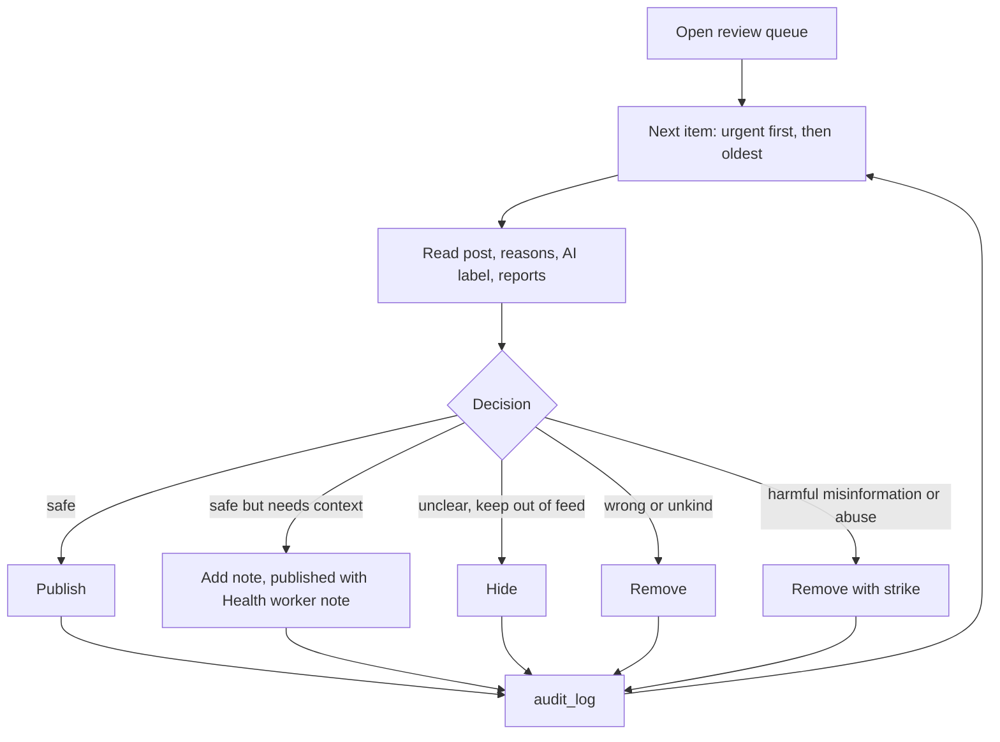

**Edge cases**
- Urgent posts: consider follow-up with the mother through the clinic (**process to be decided**).
- Health workers can also post answers directly; they are published at once with a badge.

### 6.3 Opening slots

**Steps**
1. Choose facility, mode (clinic or video), first start time, number of slots (1–48) and length (5–120 min,
   default 20), optional staff member → `staff_add_slots`.
2. Back-to-back slots are created; times that already exist are skipped. The number created is returned.
3. To close an open slot: `staff_cancel_slot`.

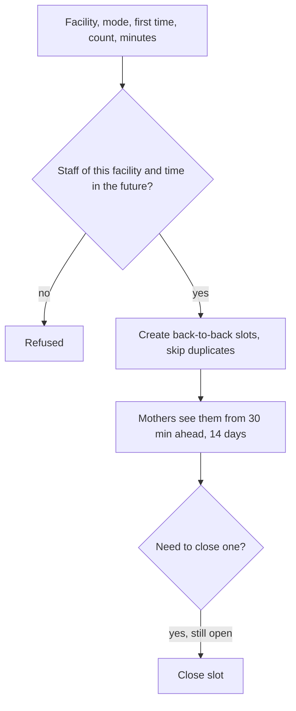

### 6.4 Running a video call

**Steps**
1. Calendar (`staff_bookings`): bookings with mother name and phone, mode, reason.
2. From 15 minutes before the start: Join → `telemed-join` → link with an owner token (Daily) → call opens.
3. If the mother does not join, staff can call her phone.

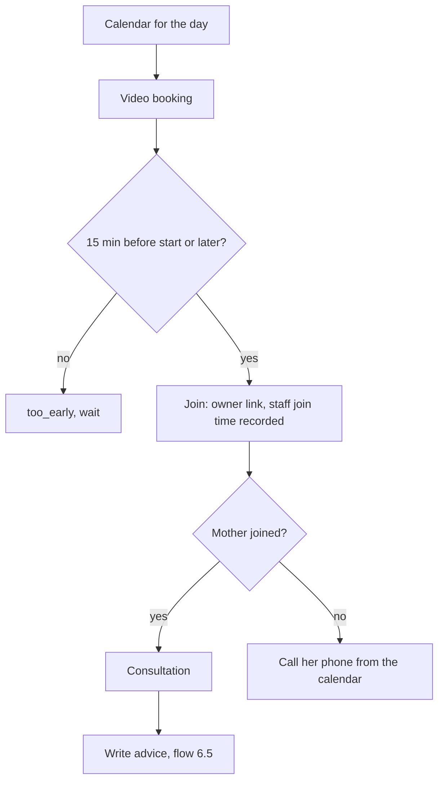

### 6.5 Writing advice after the visit

**Steps**
1. Open the booking → mark **done** or **missed** → optional advice (up to 1,000 characters) →
   `staff_set_booking_status`.
2. The mother sees it as "Health worker's advice" in her app.

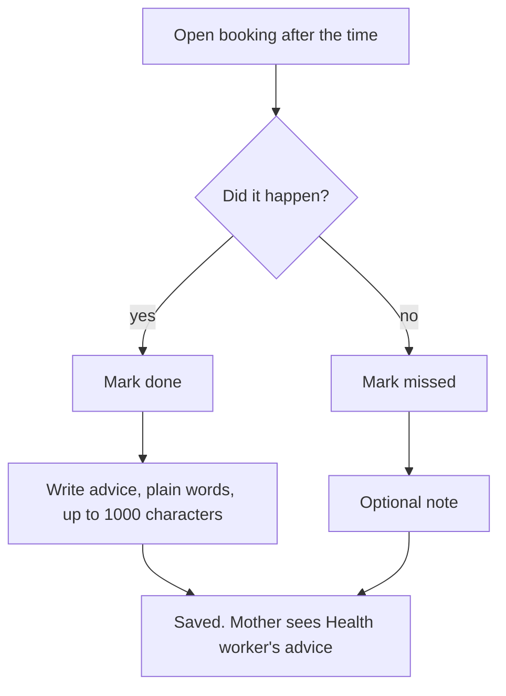

**Edge cases**
- Saving again with empty advice keeps the earlier advice.
- Advice must not replace an urgent referral: the mother's screen always adds the Emergency help line.
